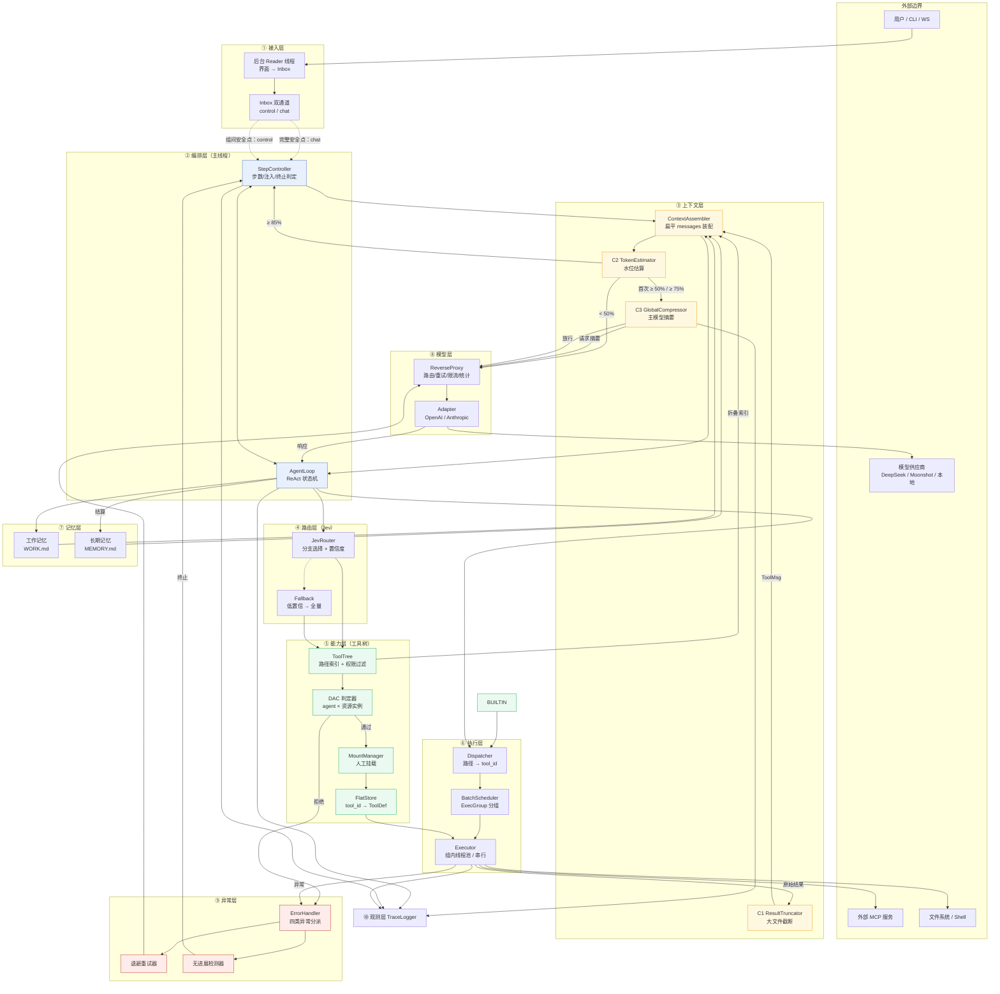
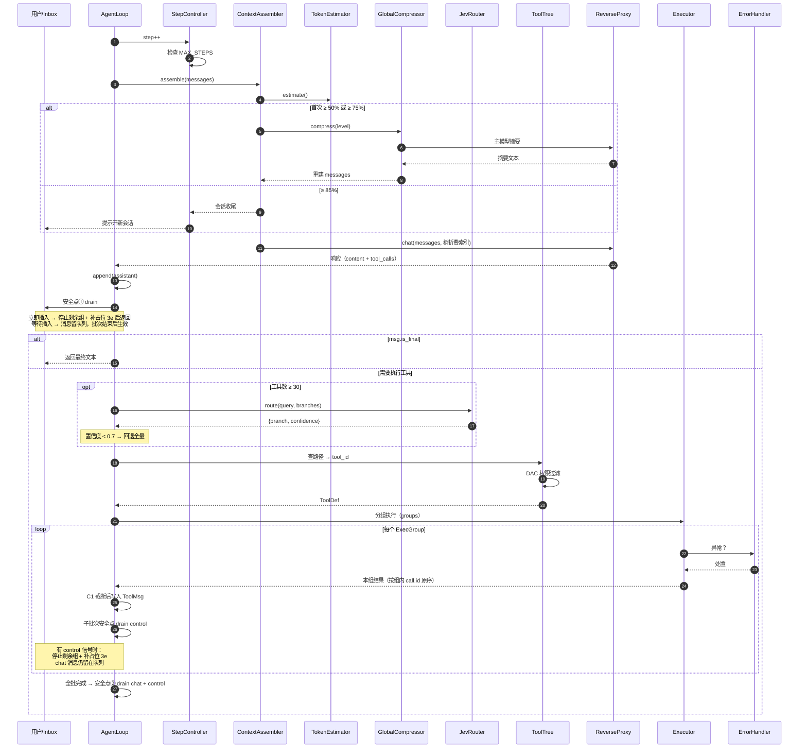
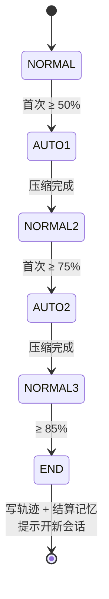

# Agent 系统架构设计

> 本文档是系统设计的唯一入口：**产品定位 → 设计原则 → 总体架构 → 模块职责 → 关键机制 → 不变量 → 实施计划**。
> 数据结构定义见 `docs/02-数据结构设计/`（入口 `README.md`）。

---

## 1. 产品定位

### 1.1 目标

构建一个**可长期运行、工具能力可扩展**的智能体平台。核心特征是：

| 特征 | 含义 |
|------|------|
| **循环推理** | 能在 ReAct 循环中调用工具并根据结果继续推理 |
| **能力可扩展** | 工具数量增长到数百个时，模型仍能准确找到并调用 |
| **多供应商** | 换模型只改配置，不改代码 |
| **可中断** | 运行期间用户可插入消息或中止 |
| **可复原** | 每步有轨迹，崩溃可定位 |

### 1.2 非目标

| 不做 | 理由 |
|------|------|
| 多 agent 协作 / 任务委派 | 不属于单 agent 能力范围 |
| 向量检索长记忆 | 引入外部依赖，收益不确定 |
| token 级流式中断 | 复杂度翻倍，中断点只需在安全点（注：**输出流式已支持**，仅中断粒度不做到 token 级） |
| 重型编排框架 | 排除 LangChain / LlamaIndex / AutoGen / CrewAI |
| 自研 tokenizer | `tiktoken` 对非 OpenAI 模型偏差大，粗估更可靠 |

### 1.3 技术约束

| 约束 | 要求 |
|------|------|
| 语言 | Python ≥ 3.12 |
| 依赖 | 仅 `httpx` / `openai` / `pydantic` / `python-dotenv` / `rich` |
| 环境 | `uv` 管理，禁止 pip 全局安装、禁止 conda |
| 版本管理 | git，阶段分支 `stage-<名>`，提交格式 `<类型>: <描述>` |

---

## 2. 设计原则

| 原则 | 含义 | 落地方式 |
|------|------|---------|
| **前缀稳定性优先** | 新增能力不得改动已固定的上下文前缀 | `messages[0]` 逐字节不变；树展开走工具返回值 |
| **失败即数据** | 异常不中断循环，降级为可被模型观察的结果 | 四类异常统一回填 |
| **优化可回退** | 性能优化必须能无损退化为朴素实现 | Jev 路由失败 → 全量索引 |
| **非法状态不可构造** | 用类型系统阻止错误，而不是运行时检查 | 消息按角色多态 |
| **能力归属唯一** | 一个能力只有一个可达路径 | 工具树路径即归属 |

---

## 3. 总体架构

### 3.1 十层结构



### 3.2 一次 ReAct 步的时序



---

## 4. 模块职责

### 4.1 接入层

| 模块 | 职责 | 关键约束 |
|------|------|---------|
| **Reader** | 后台线程将界面输入写入 `Inbox` | 唯一写入方 |
| **Inbox** | 双通道队列：`control` / `chat` | 两条通道不得合并 |

**两个界面功能对应两个通道**：

| 界面功能 | 通道 | 生效时机 | 剩余工具 |
|---------|------|---------|---------|
| **等待插入**（默认） | `chat` | 下一个完整安全点 | 继续执行 |
| **立即插入** | `control` | 下一个子批次安全点 | 停止执行，补占位 3e |

`control` 通道的元素是 `InterruptRequest`，`reason` 只能取三值：`user_abort`（用户点击）、`session_end`（上下文收尾）、`timeout`（工具超时）。

### 4.2 编排层

| 模块 | 职责 | 关键约束 |
|------|------|---------|
| **AgentLoop** | ReAct 状态机本体，唯一控制流 | 不直接执行工具、不直接构造 messages |
| **StepController** | 步数闸门、注入计数、终止判定 | 会话收尾由它统一触发 |

### 4.3 上下文层

仅 **3 项能力**：

| # | 能力 | 触发 | 动作 |
|---|------|------|------|
| **C1** | 大文件截断 | 单条结果 > 4000 字符 | 头尾各半 + 省略提示 |
| **C2** | 水位估算 | 每次 `chat()` 前 | `chars / 2.0` 粗估 |
| **C3** | 分段自动压缩 | 首次跨越 50% / 75% | 主模型摘要，保留最近 K 条 |

水位定义：

```
AUTO_1       = 0.50 × CAPACITY
AUTO_2       = 0.75 × CAPACITY
SESSION_END  = 0.85 × CAPACITY    # 不压缩，收尾并提示开新会话
```

| 模块 | 职责 |
|------|------|
| **ContextAssembler** | 扁平 messages 装配，`messages[0]` 固定 |
| **C1 ResultTruncator** | 写 `ToolMsg` 前的唯一截断入口 |
| **C2 TokenEstimator** | 粗估 token，判定水位 |
| **C3 GlobalCompressor** | 按 CallRecord 边界折叠历史；摘要使用 `ToolMsg.name` 标注工具路径 |

**C3 状态机**



**三条硬约束**：边界只落在 CallRecord 之间；保留段以完整 CallRecord 起始；每个水位只触发一次。

### 4.4 路由层（Jev）

| 模块 | 职责 | 关键约束 |
|------|------|---------|
| **JevRouter** | 用 Jev `Choice` 原语选工具分支 | `state` 只放 query，**不放工具输出**（防 JPDH） |
| **Fallback** | 低置信/异常回退全量 | 失败不得阻断主流程 |

**启用条件**：`tool_count ≥ 30` 且 `branch_count ≥ 6` 且 `history_tokens > 4000`。

Jev 规格：商业 System One 模型，三种原语（Choice ≤255 项 / Score 2–10 档 / Noul 真假），输入 $0.042/MTok，输出免费，$P(yes)$ 等概率校准良好（Choice ECE ≈ 0.028）。

### 4.5 能力层（工具树）

| 模块 | 职责 | 关键约束 |
|------|------|---------|
| **FlatStore** | 扁平存储，唯一真源；每条目自带完整 `path` | 模型不可见；挂载只写入这里 |
| **ToolTree** | 从 `FlatStore` 派生的树视图，可多级嵌套 | 不持久化，启动或变更时重建 |
| **DAC** | 单主体权限判定：`AgentPermissions.grants[path]`，无记录则允许 | 判定在查询时，非执行时 |
| **MountManager** | 人工触发挂载/卸载 | 卸载用 `retired` 标记；加载只影响新会话 |

**两层结构**：

```
FlatStore（唯一真源，模型不可见）   path 在每条目上，按 tool_id 索引
ToolTree（派生视图，模型可见）      path → ToolNode → tool_id
```

**树是视图，不是存储**：无论 tool / skill / mcp，在系统中都以扁平条目存储。树由 `path` 分段聚合而成，L1 恰为 `tool` / `skill` / `mcp` 三者之一，之上可多层嵌套。节点 `kind` 也由构建期派生（有子节点即 `abstract`）。

同名工具靠**路径消歧**：

```
/mmd/render/export → t_0a3f   (视频导出)
/web/render/export → t_1c9e   (网页截图)
```

**每个节点都是能力**：树上没有纯分类节点，只有两种 `kind`：

| kind | 含义 | 调用行为 |
|------|------|---------|
| `abstract` | 抽象能力，即子树查询入口 | 执行 `tree_query`，返回下一层子节点 |
| `leaf` | 具体工具 | 执行 `ToolDef.fn` |

`abstract` 节点同样拥有自己的 `ToolDef`（`fn = tree_query(node)`，参数为空对象）。因此调用链与真实工具完全一致：

```
path → ToolNode → tool_id → ToolDef → fn → ExecResult
```

`Dispatcher` 不需要为抽象节点开特殊分支。`tree_query` 函数本体无独立 `tool_id`，与 `read_file` 可注册到多处是同一模式。

**schema 只下发一次**：`abstract` 调用返回下一层子节点的 `path` / `name` / `kind` / `description` / `schema`；已下发过 schema 的节点仅返回前四项。`TreeQueryState.delivered` 记录已下发路径，上下文压缩时清空。

**已发现工具清单**：`tree_query` 返回的节点**按 `kind` 分流**——叶子写入 `DiscoveredTools`（`path` + `description` + `kind` + **完整 `schema`**，上限 50 条，按 `(last_used_step, first_seen_step, path)` 淘汰），抽象节点只记为"已展开路径"而不入缓存。清单在**投影时以末尾临时 `system` 消息**交给模型，由其判定调用哪个工具——**不进入 `messages` 历史**，因此不破坏前缀稳定与 KV cache。

**声明数组必须覆盖已展开路径**：中间节点即使不进缓存，也要出现在请求的 `tools` 声明里，否则模型知道了路径却无法调用，只能退回上级反复下钻（实测 9 次下钻、0 次真实调用）。工具声明 = 根索引 + 已展开路径 + 已发现叶子。

**下钻轮次的清理时机**：纯下钻批次必须完整保留（模型还需要这些子节点）；一旦本批次出现**具体工具调用**，整条下钻链立即从消息历史剪除——它揭示的工具已进缓存，留着只会让模型重读脚手架。门控条件不可省：无脑剪枝会导致同一路径被无限重复下钻。

**树在上下文中的呈现**：

```
核心层默认（DEFAULT_INDEX_DEPTH = 0，全展开）：
系统提示词里给出完整索引，模型直接选取叶子。

Web 层默认（apps/server 的 INDEX_DEPTH = 1，只暴露 L1）：
/tool      — 操作系统能力
/skill     — 可加载的技能包
/mcp       — 外部 MCP 服务
再深一层须用 tree_query 逐级下钻。
```

两种模式并存：核心层保证「不依赖下钻也能工作」，Web 层刻意压到 L1 以验证并利用下钻协议。深度大于 0 时，未展示的更深节点会以「（另有 N 个更深节点，用 tree_query 按上级路径展开）」提示模型。

子树展开与 schema 下发都通过 **`ToolMsg` 返回值**传递，`messages[0]` 永不改动。

**skill 的两种节点**：`abstract`（技能包目录）继续树查询；`leaf`（具体 `.md` 文件）读取内容作为使用说明返回，**不注册新工具、不改树结构**。所有能力在人工挂载时已注册完毕，树在会话内固定。

### 4.5.1 `messages[0]` 的五段组成

| # | 段 | 来源 |
|---|----|------|
| 1 | 系统要求（响应格式、工作记忆读写模式） | 代码内常量 |
| 2 | 工具树索引（默认 L2） | `ToolTree` |
| 3 | 长期记忆引用（仅文件名） | `MemoryStore` |
| 4 | 角色与行为准则 | 代码内常量 |
| 5 | 会话上下文（工作目录、工作记忆相对路径、可选目标） | `Session` |

五段以固定分隔符拼接，会话内逐字节不变。工作记忆正文**不进** `messages[0]`：`<workdir>/WORK.md` 由 agent 按第 1 段定义的模式在必要时读写，结果以 `ToolMsg` 返回。`session_id` / 租户 / 创建时间等系统标识不进 `messages[0]`。

### 4.6 执行层

| 模块 | 职责 | 关键约束 |
|------|------|---------|
| **Dispatcher** | 路径 → tool_id，未注册视为 3b | 不做权限判定 |
| **BatchScheduler** | 产出 `ExecGroup` 序列（safe 相邻合并 / exclusive 独占） | 分组一次成型，执行期不可变 |
| **Executor** | 按组执行、异常捕获 | 组内结果按 `call.id` 原序回填 |
| **安全点闸门** | 每个组完成后检查 `control`；全批完成后检查两通道 | 组间不消费 `chat` |

并发判据不是"是否 IO"，而是副作用是否可交换。`safe` 可并行，`exclusive` 必须串行；保守默认 `exclusive`。

### 4.6.1 子批次与安全点

一个批次被切成若干 `ExecGroup`，**组是提交的原子单位**：一组执行完毕并回填 `ToolMsg` 后，历史才处于合法态。

```
LLM 返回 5 个调用
  group[0] = [c1, c2]  safe   并行 → 回填 → 安全点
  group[1] = [c3]      excl   → 回填 → 安全点
  group[2] = [c4, c5]  safe   并行 → 回填 → 安全点 → 批次安全点②
```

| 时机 | `chat`（等待插入） | `control`（立即插入） |
|------|------------------|---------------------|
| LLM 返回后 | 允许 | 允许 |
| 组间（有后续组） | **禁止**（留在队列） | 允许：停止剩余组 + 补占位 |
| 组内执行中 | 禁止 | 禁止 |
| 全批完成 | 允许 | 允许 |

**“立即”的真实含义**：中断信号最早在下一个组边界生效，最坏延迟 = 当前组内最慢工具耗时。`Executor` 检测到超时只能写信号，不能中断同组其他工具——组是提交的原子单位，提前中止会留下无法提交的半截结果。界面文案不得承诺更强语义。

**为什么组间不消费 `chat`**：`UserMsg` 会插到未闭合的 `tool_calls` 序列中间，严格校验的 provider 直接 400。而且用户只是补充一句话时，通常不需要中断已经在跑的工具。

**为什么不在单个工具结束时插**：并行下“某个工具完成”不等于“可提交前缀”，保序前缀可能被一个慢调用卡住；子批次已经把这个粒度做到并发分组的天然边界，不需要牺牲并发。

### 4.7 记忆层

| 类型 | 内容 | 读取 | 写入 |
|------|------|------|------|
| **工作记忆** | `<workdir>/WORK.md`，自由文本，**每个工作目录一份**；同工作目录多会话共享 | agent 通过文件工具 | agent 通过文件工具（原子写） |
| **长期记忆** | `<global>/.agent/MEMORY.md`，全系统唯一一份，跨会话与跨项目累积 | `SystemMsg` 第 3 段只列文件名 | **仅**后台提取程序 |

**结算提取**：用户下发控制指令 → `control` 通道中断当前批次 → 后台 LLM 按**全系统唯一**的提取原则读工作记忆，向长期记忆追加 `MemoryEntry`。提取在独立线程运行，不阻塞主循环。

**会话持久化**：会话历史存入 SQLite（`<workdir>/.agent/orange.db`，WAL 模式），两张表 `sessions` / `messages`。`SystemMsg` 不入库，恢复时按当前工具树重新装配。事务单元为单个 `ExecGroup`，因此崩溃不会留下未闭合的 `tool_calls`，无需额外修复流程。`TraceEvent` 仍为每会话一份 JSONL。

### 4.8 模型层

| 模块 | 职责 |
|------|------|
| **ReverseProxy** | 全局并发与速率限流、成本归集、退避重试、故障转移 |
| **Adapter** | 供应商差异转换 |

多会话共享同一代理，因此限流、退避与故障转移均为**全局状态**：`RateWindow` 滑动窗口限制请求数与 token，`ProviderHealth` 统一描述 `healthy` / `degraded` / `down`。任一会话触发的故障会立刻影响所有会话，避免各自盲目重试。每次 LLM 调用的用量与成本写入 SQLite `usage` 表，按 `session_id` 归集。

**不引入 LiteLLM**：`openai` SDK 已覆盖全部 OpenAI 兼容端点，自写代理约 150 行。C3 摘要复用同一通道。

### 4.9 异常层

| 异常 | 处置 | 上限 |
|------|------|------|
| 1 ModelError | 全局退避（`ProviderHealth`），失败达阈值则切换 provider | 3 次 |
| 2 ContextOverflow | 50%/75% 自动压缩；≥85% 收尾提示 | 2 次 |
| 3a PermissionDenied | 回填替代工具 | 换工具 3 次 |
| 3b ToolNotFound | 重建索引 + 回填建议 | 换工具 3 次 |
| 3c ExecutionError | 退避重试（仅幂等工具） | 2 次 |
| 3d ArgumentMismatch | 四道关卡校验，回填具体错误；不自动修复 | 并入死锁判据 |
| 3e Aborted | 补占位 `ToolMsg`（`status: skipped`），不重试 | — |

**终止判据**：连续 3 次失败且结果 hash 未变且未换工具路径 → 判定死锁。

**幂等性决定能否自动重试**：`read_file` 可重试；`write_file` / `run_shell` 不可，回填 `retryable: false` 由模型决策。

**中断补占位**：`control` 信号发生在组间时，须为本批全部未回填调用补齐 `ToolMsg`（`error_type="3e"`，`content={"status": "skipped", "reason": "<InterruptRequest.reason>"}`，`retryable=false`），否则下一轮 API 400。

### 4.10 观测层

| 模块 | 职责 |
|------|------|
| **TraceLogger** | 每步追加一行 JSONL，崩溃时已有部分轨迹 |

---

## 5. 机制与模块映射

| 机制 | 主承载 | 协作 | 副作用边界 |
|------|--------|------|-----------|
| 工具树 + DAC + 人工挂载 | FlatStore / ToolTree / DAC / MountManager | ContextAssembler、JevRouter | 只通过 ToolMsg 与临时注入表达 |
| 工作记忆 + 长期记忆 | MemoryStore | ContextAssembler | 工作记忆自由文本、经工具读写；`messages[0]` 仅含长期记忆文件名 |
| C1 / C2 / C3 | Truncator / Estimator / Compressor | Executor、Proxy | 截断单条；压缩重建历史 |
| 反向代理 + 适配器 | Proxy / Adapter | 所有 LLM 调用 | 对上层透明 |
| 四类异常 | ErrorHandler | Executor / Compressor / Proxy | 降级为 Observation |
| 安全点插话 | Inbox / Reader / StepController | AgentLoop | `chat` 只在完整安全点追加 UserMsg |
| 立即插入 | `control` 通道 / StepController | AgentLoop、BatchScheduler | 停止剩余组 + 补 3e 占位 |

---

## 6. 不变量

| # | 不变量 | 违反后果 | 守护者 |
|---|--------|---------|--------|
| **I1** | `messages[0]` 逐字节稳定 | KV cache 全废 | ContextAssembler / MountManager |
| **I2** | 每个 `tool_call` 必须有配对 `tool` 消息 | API 400 | 消息多态 / GlobalCompressor |
| **I3** | 权限不足的节点不出现在查询结果中；直接调用返回 3a | token 浪费 + 幻觉 | ToolTree / DAC |
| **I4** | 优化失败必须无损退化 | 优化变故障点 | Fallback / BatchScheduler |
| **I5** | C3 每水位只触发一次；≥85% 只收尾 | 反复压缩丢失上下文 | StepController / GlobalCompressor |
| **I6** | `UserMsg` 不得插入未闭合 `tool_calls` 序列内部 | API 400 / 语义错乱 | 安全点闸门 / AgentLoop |

---

## 7. 关键设计决策

| 议题 | 结论 | 核心理由 |
|------|------|---------|
| **循环模型** | 同步 ReAct 循环 | 逻辑最简，中断点清晰 |
| **消息并发** | 后台线程 + 队列，不阻塞主循环 | LLM 阻塞 3–30s 是唯一空窗 |
| **多工具并发** | `ThreadPoolExecutor`，safe/exclusive 分组 | asyncio 需全链路改写，收益不对等 |
| **LLM 空窗利用** | 只做输入收集与日志落盘 | 投机执行副作用不可撤回 |
| **插话中断** | 仅安全点（LLM 返回后 / 批次完成后） | 工具中途中断会留半截状态 |
| **安全点粒度** | 子批次（并发分组边界） | 单个工具边界需牺牲并发且前缀可能被卡住；整批边界响应太迟 |
| **插话分两档** | 界面提供“等待插入 / 立即插入”，对应 `chat` / `control` | 大多数补话不需打断；真要停时不应等整批 |
| **组间不消费 chat** | 消息留队列至完整安全点 | 避免 `UserMsg` 插入未闭合 `tool_calls` 序列 |
| **立即插入机制** | 补占位 `tool` 消息修复历史 | 否则下次续聊 API 400 |
| **挂载由人工完成** | `FlatStore` 是唯一真源，树自动派生 | 保证前缀稳定；模型不参与能力管理 |
| **已发现工具清单** | 投影时末尾追加临时 system 消息 | 不写入 `messages`，不破坏 KV cache；由模型自行判定调用 |
| **工具树启用阈值** | 工具数 < 15 全量暴露 | 少量工具查树纯亏推理 |
| **Jev 用途** | **仅工具路由** | 路由是其最强项（151 类 89.5%） |
| **Jev 失败** | 低置信 → 回退全量 | 路由是优化不是关键路径 |
| **上下文管理** | 仅 C1 / C2 / C3 | 复杂机制收益不抵风险 |
| **C3 触发** | 50% / 75% 各一次，85% 收尾 | 分两次压缩保真度高于一次 |

---

## 8. 实施计划

| 步 | 内容 | 依赖 | 验收 |
|----|------|------|------|
| 1 | `Message` / `ToolCall` 多态 + 投影 | — | 无损序列化 |
| 2 | `ToolTree` / `ToolDef` / DAC | — | 路径解析 + 权限过滤 |
| 3 | abstract 节点自带树查询 + schema 单次下发 | 1,2 | 调用抽象节点能展开子树 |
| 4 | C1 / C2 / C3 | 1 | 截断生效、压缩后合法 |
| 5 | `BatchPlan` + `ExecGroup` 并发分组 + 子批次安全点 | 2 | 分组无损、结果按组序回填、中断补占位 |
| 6 | 记忆 | 1 | 跨会话注入 |
| 7 | Jev 路由 + Fallback | 2 | 低置信不阻断 |
| 8 | 异常四类 | 1–5 | 每类有回填 |
| 9 | 插话（`chat` / `control` 双通道） | 1, 5 | 等待插入不打断；立即插入停剩余组 + 补 3e |
| 10 | `TraceEvent` | 全部 | 逐步 JSONL |

**步 1–4 为 MVP 骨架**，完成后可端到端跑通一次工具调用。

### 复杂度账本

| 层 | 模块 | 行数 | 占比 |
|----|------|------|------|
| 能力层 | 5 | 420 | 24% |
| 模型层 | 2 | 250 | 14% |
| 编排层 | 2 | 220 | 13% |
| 执行层 | 3 | 200 | 11% |
| 异常层 | 3 | 200 | 11% |
| 上下文层 | 4 | 180 | 10% |
| 记忆层 | 2 | 150 | 9% |
| 路由层 | 2 | 150 | 8% |
| 接入层 | 2 | 60 | 4% |
| 观测层 | 1 | 60 | 4% |
| **合计** | **26** | **~1890** | |

---

## 9. 配置项

```bash
# 模型
# 密钥只从环境变量读取（.env 或进程环境），代码中不出现明文
DEEPSEEK_API_KEY=sk-xxx
DEEPSEEK_BASE_URL=https://api.deepseek.com
DEEPSEEK_MODEL=deepseek-chat

# 生成
LLM_TEMPERATURE=0.7
LLM_MAX_TOKENS=4096
LLM_TIMEOUT=60
LLM_MAX_RETRIES=2

# 上下文水位
CONTEXT_CAPACITY=32768
AUTO_COMPRESS_1=0.50
AUTO_COMPRESS_2=0.75
SESSION_END=0.85
MAX_OBS_CHARS=4000

# 循环
MAX_STEPS=20
MAX_INJECTS=10

# 工具树
TREE_ENABLE_THRESHOLD=15
JEV_ROUTE_ENABLE_THRESHOLD=30

# 执行
MAX_WORKERS=4
```
