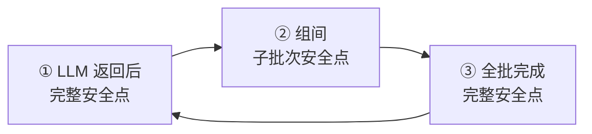

# 接入层（G 组）

> 返回 [总览](README.md)

---

## 1.1 双通道语义

用户界面的两个入口与内部结构一一对应：

| 界面功能 | 入队通道 | 行为 |
|---------|---------|------|
| **等待插入**（默认） | `chat` | 不打断工具，等到下一个**完整安全点**（① LLM 返回后 / ③ 全批完成后）才插入 |
| **立即插入** | `control` | 在**子批次安全点**（②）生效：停止剩余组，补占位，立即插入 |

## 1.2 安全点编号



| 编号 | 位置 | 消费 `chat` | 消费 `control` |
|------|------|------------|---------------|
| ① | LLM 返回后 | 是（全部） | 是（本轮直接结束，无工具可停） |
| ② | 每个 `ExecGroup` 完成后（尚有后续组） | **否**，留在队列 | 是（首个信号，消费后清空通道） |
| ③ | 全批完成 | 是（全部） | 是（无剩余组，行为同①） |

> `len(groups) == 1` 时 ② 与 ③ 重合，`control` 由 ③ 消费，语义仍为“停止本批剩余组”（无剩余组则等效立即返回）。

## 1.3 字段定义

```
Inbox
├── control: Deque[InterruptRequest]     立即插入通道，容量无限
├── chat: Deque[UserInput]               等待插入通道，FIFO，容量上限 100
└── lock: threading.Lock                 保护两通道读写

UserInput
├── text: str                            原始文本，不做改写
├── channel: "stdin" | "ws"              来源通道
└── ts: float                            入队时刻 Unix 时间戳

InterruptRequest                      中断信号（中断本批剩余工具）
├── reason: "user_abort" | "session_end" | "timeout"
├── text: str | None                     附带文本；非空时在补占位后作为 UserMsg 插入
└── ts: float
```

`reason` 取值：

| 值 | 触发源 | 写入线程 | `text` |
|----|--------|---------|--------|
| `user_abort` | 用户点击「立即插入」 | `Reader` | 可非空 |
| `session_end` | 上下文 ≥ 85% 收尾 | `StepController` | 恒 `None` |
| `timeout` | 工具执行超时 | `Executor` | 恒 `None` |

`Inbox` 在此意义上是一条**中断信号总线**：任何能观察到“应当停止”的线程都可写入，只有主线程在安全点消费。

## 1.4 操作接口

```
put_chat(UserInput) -> None
put_control(InterruptRequest) -> None
take_control() -> InterruptRequest | None   消费首个并清空通道
drain_chat() -> list[UserInput]            全部取走，保持 FIFO 顺序
```

## 1.5 消费规则

| 安全点 | 消费 `control` | 消费 `chat` | 顺序 |
|--------|---------------|------------|------|
| ① LLM 返回后 | 是 | 是（全部 drain） | 先 control 后 chat |
| ② 组间 | 是（首个） | **否** | 停止剩余组 + 补 3e |
| ③ 全批完成 | 是 | 是（全部 drain） | 先 control 后 chat |
| 组内执行中 | 否 | 否 | 不访问 `Inbox` |

## 1.6 约束

| # | 约束 |
|---|------|
| G1 | `control` 一旦被消费，必须停止本批剩余组并补占位（3e），不得继续执行 |
| G2 | `chat` 消息在 ② 不得出队，也不得丢弃 |
| G3 | `control` 信号 `text` 非空时，在全部补占位完成后 `append(UserMsg)` |
| G4 | 同一次 drain 中两通道均有消息时，先处理 `control`，再处理 `chat` |
| G5 | 写入方可多个（`Reader` / `StepController` / `Executor`），全部须持锁；消费方仅主线程 |
| G6 | 所有读写必须持 `lock`，临界区只做队列操作，不得在锁内调用工具或模型 |
| G7 | `take_control()` 消费首个信号后必须清空 `control` 剩余元素 |
| G8 | `chat` 超过容量上限时丢弃最旧元素，并写一条 `TraceEvent` |
| G9 | 本轮因 `control` 结束时，必须同时 `drain_chat()` 并将其附在本轮末尾 |
| G10 | 主线程不得在组内执行中访问 `Inbox` |
| G11 | `reason` 只能取三个固定值；`user_abort` 之外的取值 `text` 必须为 `None` |
| G12 | `put_chat` 必须拒绝空文本（`text` 为空串时丢弃并写一条 `TraceEvent`） |

## 1.7 生效延迟

中断信号**不保证立即生效**，其生效时刻恒为下一个安全点：

| `reason` | 最早生效点 | 最坏延迟 |
|----------|-----------|---------|
| `user_abort` | ② 组间 | 当前组最长单个工具耗时 |
| `timeout` | ② 组间 | 当前组最长单个工具耗时（含并行组内并发的慢工具） |
| `session_end` | ① 或 ② | 一轮 LLM 调用耗时 |

`Executor` 在组内检测到超时后只能**写入信号**，无法中断同组其他工具：组是执行与提交的原子单位，提前中止会留下无法提交的半截结果。

因此“立即插入”的准确含义是**最近一个组边界**，而非当前指令立即停止。实现与界面文案都不得承诺更强语义。
