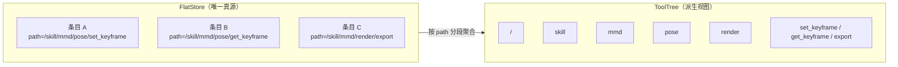

# 工具与权限（B 组）

> 返回 [总览](README.md)

---

## 4.1 核心模型：树是视图，存储是扁平的



| | 扁平存储 | 工具树 |
|---|---|---|
| 角色 | **唯一真源** | **派生视图** |
| 单位 | 一条条目一个 `path` | 一个节点一个路径前缀 |
| 持久化 | 是（代码注册或配置） | 否，启动时重建 |

**树高不固定**，但语义分层如下：

| 层 | 名称 | 说明 |
|----|------|------|
| L0 | 根层 | `/` |
| L1 | 资源层 | 恰为 `tool` / `skill` / `mcp` 三者之一 |
| L2+ | 任务组层 | 可多层嵌套 |
| 末层 | 实际工具层 | 叶子节点 |

## 4.2 字段定义

```
FlatStore                             唯一真源
├── entries: dict[str, ToolDef]        key = tool_id
└── 每条 entry 自带 path，按 path 索引

ToolDef
├── tool_id: str                        全局唯一
├── path: str                           完整绝对路径，扁平条目自带
├── fn: Callable                        执行函数（abstract 为 tree_query）
├── schema: dict                        JSON Schema
├── concurrency: "safe" | "exclusive"   默认由 caps 推导
├── idempotent: bool                    默认 false
├── caps: list[str]                     read | write | exec | net
├── permission: Permission
├── side_effect_scope: "session" | "project" | "global"
├── description: str                    一行，≤ 40（L1）/ 80（深层）
├── synthetic: bool                     是否为构建期自动合成的中间节点
└── retired: bool                       已卸载，仅保留供执行中引用

ToolNode                              派生视图节点，不独立存储
├── path: str
├── name: str                           最后一段
├── kind: "abstract" | "leaf"           派生：有 children 即 abstract
├── description: str
├── schema: dict
├── tool_id: str
├── children: list[ToolNode]            仅 abstract 非空
├── permission: Permission
└── side_effect_scope: "session" | "project" | "global"

ToolTree                              视图，从 FlatStore 派生
├── root: ToolNode
├── version: int                        每次变更递增
└── 约束：不独立持久化，启动或变更时重建

DiscoveredTools                       会话级，已发现的**叶子**工具清单
├── entries: dict[str, ToolDiscovery]   key = path
└── max_entries: int = 50

ToolDiscovery
├── path: str
├── description: str                    > 80 字符时截为 79 + "…"
├── kind: "abstract" | "leaf"           仅 "leaf" 会入缓存，见下方说明
├── first_seen_step: int
├── last_used_step: int
└── schema: dict                        完整参数 schema，使其可被直接调用

Permission                             节点声明的资源类型
├── src: "tool" | "skill" | "mcp"       决定对应哪个权限位
└── caps: list[str]                     用于并发与风险标注

AgentIdentity                          多 agent 预留，当前单实例
├── agent_id: str
└── role: "owner"                       预留，当前恒为 owner

AgentPermissions                       按 agent 存，与共享树分离
├── agent_id: str
└── grants: dict[str, bool]             key = 资源绝对路径，value = allowed

TreeQueryState                          会话级，记录已下发过 schema 的节点
├── delivered: set[str]                 已完整返回过 schema 的 path
└── 约束：上下文压缩（能力 C3）发生时清空
```

## 4.3 权限模型

单主体（agent）+ 三类资源，类比 Linux owner 位。

| 资源类型（`src`） | 权限位 | 含义 |
|------------------|--------|------|
| `tool` | `call` | 工具是否可调用 |
| `skill` | `read` | skill 是否可读 |
| `mcp` | `request` | mcp 是否可请求 |

**授予粒度为实例**：`grants` 的键是资源绝对路径，每个工具/skill/mcp 条目单独授权。

**判定流程**：

```
1. 取节点 path 与 permission.src
2. 查 AgentPermissions.grants[path]
     无记录 → 默认允许
     true  → 允许
     false → 拒绝
```

| 场景 | 查询（树索引 / tree_query） | 直接调用 |
|------|---------------------------|---------|
| 拒绝 | 不返回该节点（不泄露能力面） | 返回 `3a PermissionDenied` |

`side_effect_scope` 不参与权限判定，仅用于风险提示、并发参考与审计。

## 4.4 `kind` 语义

| kind | 含义 | `children` | 调用行为 |
|------|------|-----------|---------|
| `abstract` | 抽象能力，即子树查询入口 | 非空 | 执行 `tree_query`，返回下一层子节点 |
| `leaf` | 具体工具 | 空 | 执行 `ToolDef.fn` |

所有非叶子节点都是 `abstract`，**没有纯分类节点**：树上每个路径都可调用。

## 4.5 `abstract` 节点的执行模型

每个 `abstract` 节点**都注册自己的 `ToolDef`**，`fn` 绑定 `tree_query(node)`，参数为空对象：

```
/skill/mmd
  ToolNode(path="/skill/mmd", kind="abstract", tool_id="t_tree_mmd")
  ToolDef(tool_id="t_tree_mmd", fn=partial(tree_query, node=mmd_node),
          schema={"type":"object","properties":{}}, caps=["read"])
```

因此调用链与真实工具完全一致：

```
path → ToolNode → tool_id → ToolDef → fn → ExecResult
```

`tree_query` 函数本体无独立 `tool_id`，它是被多个 `ToolDef` 共享的实现（同 `read_file` 可注册到多处）。

**返回内容**：下一级全部子节点的完整结构。

```json
{
  "path": "/skill/mmd",
  "children": [
    {"path": "/skill/mmd/pose", "name": "pose", "kind": "abstract",
     "description": "姿态与骨骼调整", "schema": {}},
    {"path": "/skill/mmd/render", "name": "render", "kind": "abstract",
     "description": "渲染输出", "schema": {}}
  ]
}
```

## 4.6 schema 只下发一次

| 情况 | `children[].schema` |
|------|--------------------|
| 该子节点 `path` 不在 `TreeQueryState.delivered` 中 | 完整 schema |
| 已在 `delivered` 中 | 省略（仅返回 `path` / `name` / `kind` / `description`） |

命中后立即将各子节点 `path` 加入 `delivered`。**上下文压缩（能力 C3）发生时清空 `delivered`**，因为模型侧已看不到旧 schema。

`tree_query` 判定 `delivered` 与写入必须在**同一把锁内**完成，否则并发查询会重复下发 schema。因此树查询可标 `safe`。

## 4.7 已发现工具清单

每次 `tree_query` 返回的节点，**按 `kind` 分流**：叶子写缓存，中间节点只记录为"已展开"。清单在投影时以**末尾临时 `system` 消息**形式交给模型，由其判定调用哪个工具（见 [消息 §3.7](03-消息.md)）。

| 行为 | 说明 |
|------|------|
| 写入 | `tree_query` 返回后，**仅为 `kind == "leaf"` 的节点** upsert 一条 `ToolDiscovery`（含 `schema`） |
| 抽象节点 | **不进缓存**——它们只是位置，不是能力，占槽位且会诱导模型重复下钻。改记录到 `SessionRunner._expanded_paths`，仅用于「保持可调用」 |
| 使用 | 模型调用某 `path` 时更新其 `last_used_step` |
| 淘汰 | 超过 `max_entries` 时按 `(last_used_step, first_seen_step, path)` 升序淘汰 |
| 清空 | 与 `delivered` 同步，上下文压缩时清空 |

> **判定依据只有 `kind`，不设 `expanded` 标志。**
> 早期版本给每条记录加过布尔字段表示"是否展开过"，模型据此误判为需再次下钻
> （实测连续 10 次下钻、0 次真实调用）。节点类型本身就区分了两者，布尔字段是
> 冗余且有害的。

### 已展开路径必须保持可调用

下钻过的中间节点即使不进缓存，也**必须出现在请求的工具声明里**。否则模型
虽然从 `tree_query` 得知 `/tool/os` 存在，却因该名称未在 `tools` 数组中而无法
调用，只能退回 `/tool` 反复下钻（实测 9 次下钻、0 次调用）。

因此 Web 层的 `tool_specs()` 在根索引之上叠加两层：

```
1. index_specs(depth=1)          → /tool, /mcp, /skill
2. _expanded_paths               → /tool/os, /tool/os/file（下钻途中经过的）
3. discovered.paths()            → /tool/os/file/read（已发现的叶子）
```

## 4.9 树的构建

### 4.9.1 构建算法

```
build_tree(flat_store, permissions) -> ToolTree
  root = Node(path="/")
  for entry in flat_store.entries (按 path 字典序):
      if not visible(entry.path, permissions): continue
      node = root
      segments = entry.path.strip("/").split("/")
      for i, seg in enumerate(segments):
          child_path = "/" + "/".join(segments[:i+1])
          node = node.children.get_or_create(seg, path=child_path)
      node.bind(entry)          # 末段绑定 tool_id 与 schema
  计算每个节点 kind：有 children → abstract，否则 leaf
```

### 4.9.2 中间节点的处理

中间节点（如 `/skill/mmd/pose`）在扁平存储中可能没有显式条目。

| 情况 | 处理 |
|------|------|
| 有显式条目 | 使用该条目的 `description` / `schema` / `tool_id` |
| 无显式条目（纯前缀） | **自动合成** `ToolDef` |

合成规则：

```
ToolDef(
    tool_id      = "t_tree_" + hash(path),
    path         = path,
    fn           = partial(tree_query, node=path),
    schema       = {"type": "object", "properties": {}},
    concurrency  = "safe",
    idempotent   = True,
    caps         = ["read"],
    permission   = 继承父节点,
    description  = "由子节点推断" 或默认值,
    synthetic    = True,
)
```

合成条目**不写入 `FlatStore`**，只存在于构建期的树中。

### 4.9.3 `kind` 是派生属性

`kind` 不作为存储字段，由构建期计算：

| 条件 | `kind` |
|------|--------|
| 有子节点 | `abstract` |
| 无子节点 | `leaf` |

### 4.9.4 构建期校验

构建完成后必须整体校验，任一失败则拒绝启动：

| 检查 | 对应约束 |
|------|---------|
| 每条 `path` 第一段 ∈ `{tool, skill, mcp}` | B19 |
| 同一父节点下 `name` 唯一 | B1 |
| 每个节点 `tool_id` 存在于 `FlatStore`（含合成的） | B2 |
| `leaf` 的节点 `schema` 与 `ToolDef.schema` 一致 | B3 |
| `abstract` 的 `schema` 为空对象 | B4 |
| `description` 单行且符合长度 | B9、B10 |

## 4.10 树的维护

### 4.10.1 挂载（mount）

挂载是**人工操作**，模型不参与、也不可触发。扁平存储的挂载只需一步，树随增量更新。

```
mount(entry):
  1. 校验 path 第一段 ∈ {tool, skill, mcp}
  2. 校验 path 在 FlatStore 中不冲突
  3. 校验 schema 合法、description 符合长度、caps 与 concurrency 自洽
  4. 写入 FlatStore（单条目）
  5. 增量更新 ToolTree：沿 path 补中间节点，末段绑定 tool_id
  6. ToolTree.version += 1
  7. 若为 leaf 且首次出现，通过 ToolMsg 告知模型
```

### 4.10.2 卸载（unmount）

卸载的影响面大于挂载，因为需要清理会话级缓存。

```
unmount(path_prefix):
  1. 从 FlatStore 将前缀下全部条目标记 retired = True
  2. 增量更新 ToolTree：移除该子树（保持 retired 条目不参与构建）
  3. ToolTree.version += 1
  4. 从所有会话的 DiscoveredTools 与 TreeQueryState.delivered 移除相关 path
```

**为什么用 `retired` 而非立即删除**：正在执行的 `ToolDef.fn` 不能被抽走，否则工具会在中途失效。`retired` 条目保留在 `FlatStore` 中，仅从树视图移除；进程重启后自然消失。

### 4.10.3 增量更新与全量重建

| 方式 | 触发 | 复杂度 |
|------|------|--------|
| **增量** | 每次 mount / unmount 沿路径局部更新 | O(路径深度) |
| **全量** | 启动时；或作为一致性自检 | O(条目数) |

全量重建同时用作**一致性校验**：重建结果与增量更新结果不一致时，记录 `TraceEvent` 并以全量结果为准。

### 4.10.4 会话与树版本

`Session` 绑定树的**快照版本**，挂载不影响进行中的会话。

| 时机 | 行为 |
|------|------|
| 会话创建 | 记录 `tree_version` |
| 挂载发生 | `ToolTree.version += 1`，已有会话继续用旧快照 |
| 新会话创建 | 使用当前最新版本 |
| 卸载发生 | 从**所有**会话的 `DiscoveredTools` / `delivered` 清理（安全必须） |

卸载例外说明：加载只影响新会话，但卸载必须影响所有会话——否则模型可能调用已不可用的工具。

## 4.11 skill 的两种节点

| 查询到的节点 | 行为 |
|-------------|------|
| `abstract`（技能包目录） | 继续走树查询，返回下一层子节点 |
| `leaf`（具体 `.md` 文件） | 读取该文件内容（使用说明 / 工作流程）并作为 `ToolMsg` 返回 |

`.md` 叶子**只提供说明内容**，不注册新工具、不改变树结构。skill 的全部工具在人工挂载时就已注册完毕。

## 4.10 约束

## 4.12 约束

| # | 约束 |
|---|------|
| B1 | 同一父节点下 `name` 唯一 |
| B2 | 每个节点的 `tool_id` 必须存在于 `FlatStore`（含构建期合成的条目） |
| B3 | `leaf` 的节点 `schema` 必须与对应 `ToolDef.schema` 完全一致 |
| B4 | `abstract` 的 `schema` 为 `{"type":"object","properties":{}}` |
| B5 | 权限判定在查询时执行：被拒绝的节点不出现在树索引与 `tree_query` 结果中；直接调用被拒绝节点时返回 `3a` |
| B6 | 树索引默认输出 L1 + L2 两级条目，按 `path` 字典序排列；L2 条目超过 40 时按 `description` 长度升序保留前 40 条 |
| B7 | 同一 `path` 在 `delivered` 中时，不得重复下发其 `schema` |
| B8 | `FlatStore` 是唯一真源；`ToolTree` 不持久化，由 `FlatStore` 派生 |
| B9 | `description` 必须单行，不含换行符 |
| B10 | L1 节点 `description` ≤ 40 字符；深层节点 ≤ 80 字符；超长时装配时截断并附省略号 |
| B11 | `concurrency` 仅当 `caps` 只含 `read` 时为 `safe`，否则为 `exclusive`；未声明 `caps` 时为 `exclusive` |
| B12 | `idempotent` 默认 `false`；仅纯读与覆盖写可标 `true`，追加写、起进程、网络写必须为 `false` |
| B13 | 所有 `abstract` 节点（含合成）的 `concurrency` 为 `safe`，`idempotent` 为 `true` |
| B14 | `TreeQueryState` 与 `DiscoveredTools` 的读写必须在同一把锁内完成 |
| B15 | `AgentPermissions.grants` 只记例外项；无记录视为允许 |
| B16 | `grants` 的键必须是完整绝对路径，且与 `ToolNode.path` 逐字符一致 |
| B17 | `Permission.src` 与节点实际资源类型必须一致；合成节点继承父节点 |
| B18 | `side_effect_scope` 不参与权限判定，不得用于拒绝或放行 |
| B19 | 每条 `path` 的第一段必须∈ `{tool, skill, mcp}`，否则拒绝挂载 |
| B20 | 中间节点无显式条目时自动合成 `ToolDef`，且 `synthetic = true`；合成条目不写入 `FlatStore` |
| B21 | `kind` 不存储，由构建期派生：有 `children` 为 `abstract`，否则为 `leaf` |
| B22 | 构建完成后必须整体校验（B1–B4、B9、B10、B19），任一失败则拒绝启动 |
| B23 | 卸载用 `retired = true` 标记，不得立即删除条目；正在执行的 `ToolDef.fn` 不得失效 |
| B24 | 挂载只对新会话生效；卸载必须清理所有会话的 `DiscoveredTools` 与 `delivered` |
| B25 | 每次 mount / unmount 后 `ToolTree.version` 递增；全量重建结果不一致时以全量结果为准并记录 `TraceEvent` |

## 4.13 `concurrency` 与 `idempotent` 推导

两者判据不同，互不影响。

**`concurrency`**：两个工具同时执行的结果是否与顺序执行等价。

| `caps` | `concurrency` |
|--------|--------------|
| `["read"]` / `["read","net"]` | `safe` |
| 含 `write` 或 `exec` | `exclusive` |
| `["net"]` 单写（POST 类） | `exclusive` |
| 未声明 | `exclusive` |

**`idempotent`**：重复执行 N 次与执行 1 次的最终状态是否相同。

| 类别 | 值 | 例子 |
|------|-----|------|
| 纯读 | `true` | `read_file`、`list_dir`、树查询 |
| 覆盖写 | `true` | 同内容 `write_file`、`set_config` |
| 追加写 | `false` | 日志追加、`WORK.md` 追加 |
| 非幂等副作用 | `false` | `git commit`、POST、`run_shell` |
| 不确定 | `false` | 默认 |

`ExecResult.retryable` **只由 `idempotent` 决定**，与 `concurrency` 无关。

| `concurrency` | `idempotent` | 自动重试 |
|--------------|-------------|---------|
| `safe` | `true` | 是 |
| `safe` | `false` | 否 |
| `exclusive` | `true` | 是（串行） |
| `exclusive` | `false` | 否 |

## 4.14 索引投影

```
tree_index(node: ToolNode, depth: int = 2) -> str

输出格式（depth=2，默认）：
/tool      — 操作系统能力
/tool/os   — 文件与进程
/skill     — 可加载的技能包
/skill/mmd — MMD 制作流水线
...

要求：
- 默认 depth=2，输出 L1 与 L2 两级条目
- 每个条目为带前导斜杠的完整前缀路径
- 仅输出索引展示，模型调用时必须传完整绝对路径（如 /os/file/read）
- 按 path 字典序
- 输出结果在会话内保持逐字节一致
- 若 L2 条目总数超过 40，按 description 长度升序保留前 40 条，其余折叠到父节点
```
