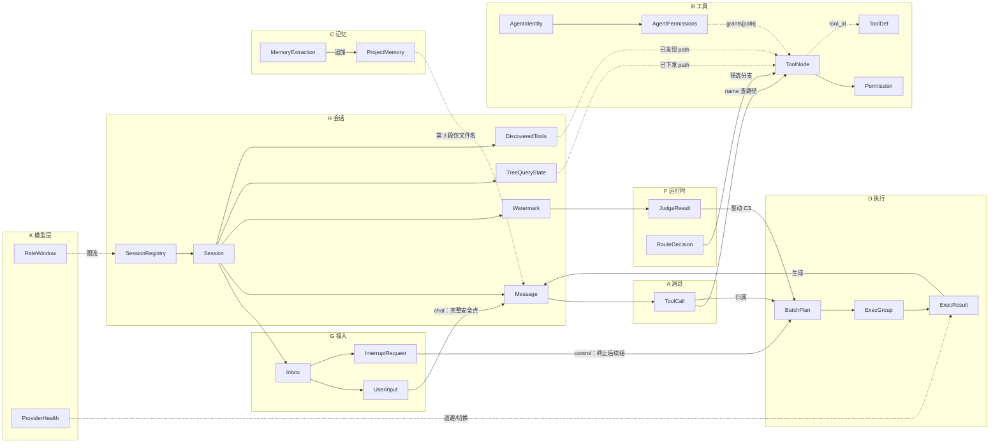

# 结构关系

> 返回 [总览](README.md)

---

## 11.1 全局关系图

## 11.2 关键引用链

| 从 | 到 | 关系 |
|----|----|------|
| `ToolCall.name` | `ToolNode.path` | 按路径查找节点 |
| `ToolNode.tool_id` | `ToolDef.tool_id` | 决策层到实现层 |
| `ToolMsg.tool_call_id` | `ToolCall.id` | 结果回填配对 |
| `ToolMsg.name` | `ToolCall.name` | 逐字符一致（A6） |
| `AgentPermissions.grants[key]` | `ToolNode.path` | 按实例授权（B16） |
| `UserInput` | `UserMsg` | chat 通道消费后转换 |
| `InterruptRequest` | `ToolMsg(3e)` | control 消费后补占位 |
| `ExecResult` | `ToolMsg` | 生成回填内容 |
| `MemoryExtraction` | `ProjectMemory` | 追加 `MemoryEntry` |
