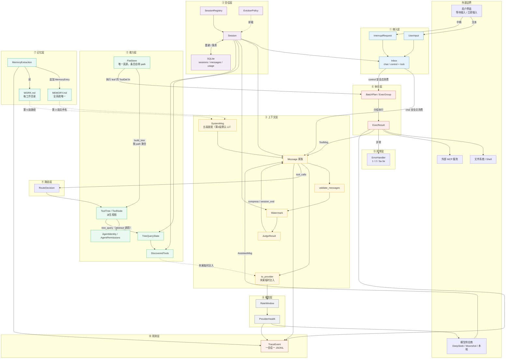
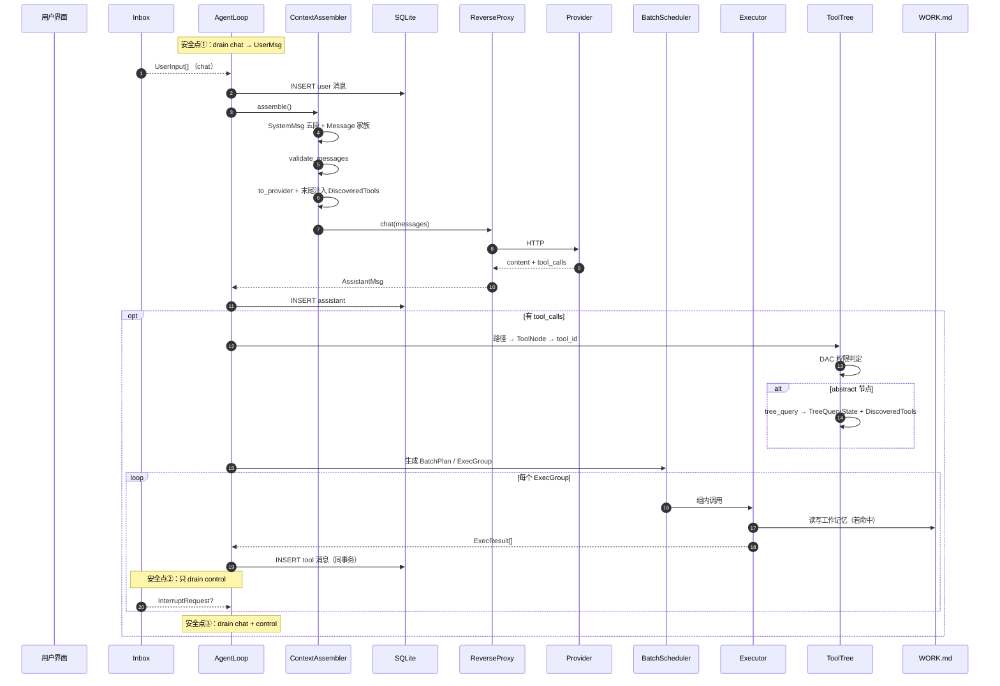
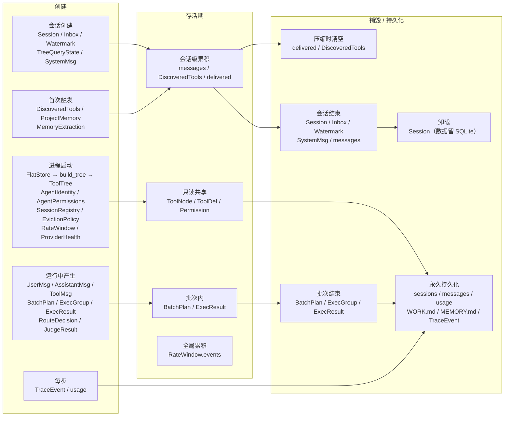
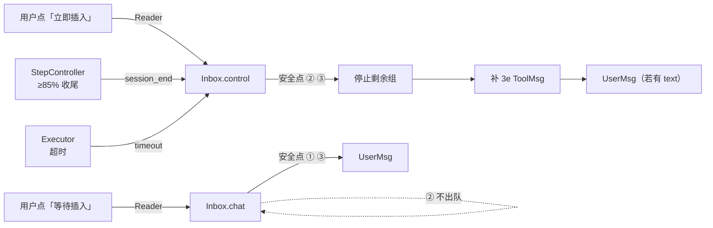
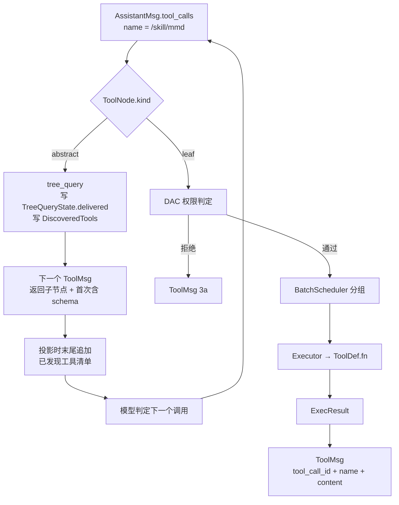
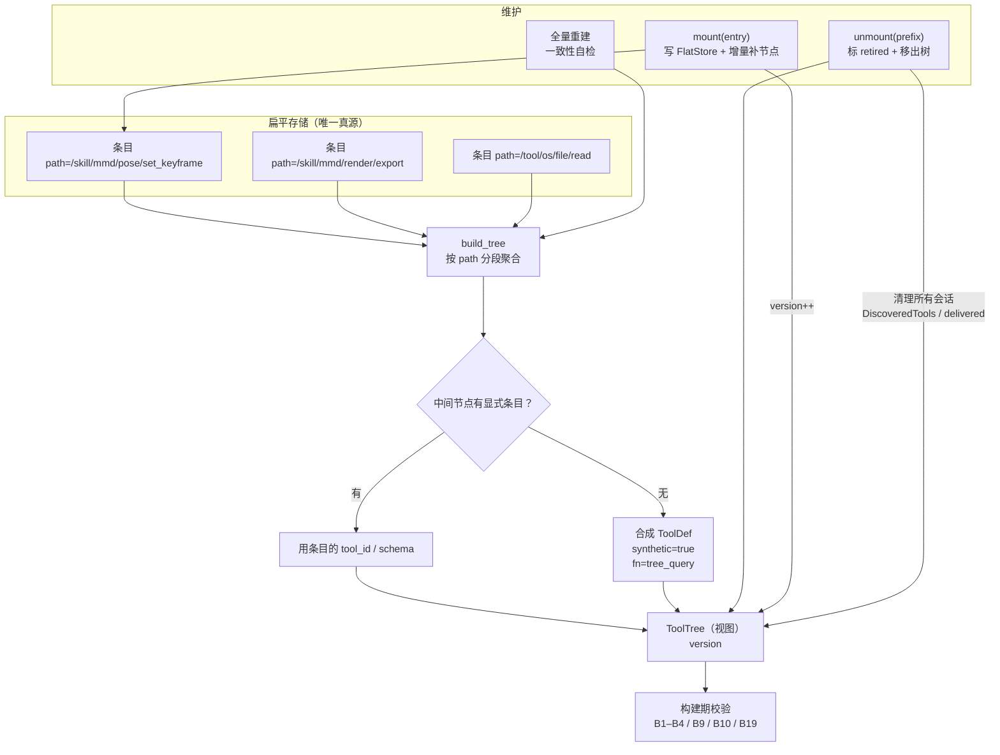
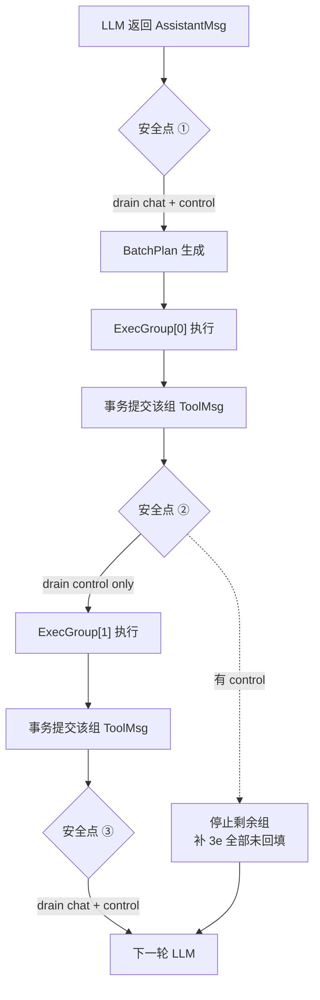
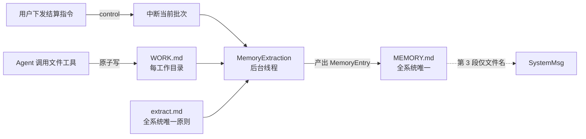
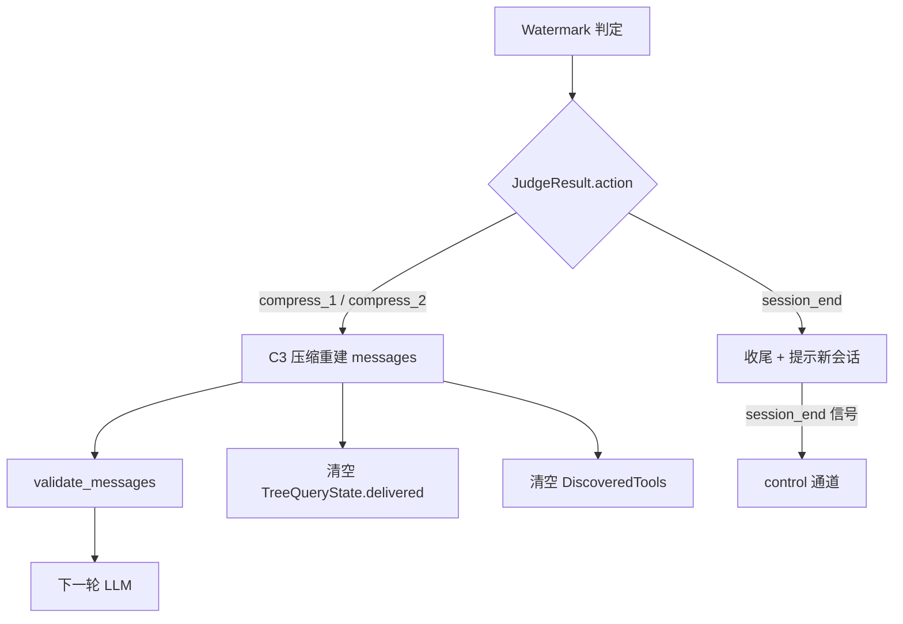

# 全系统架构与数据流

> 返回 [总览](README.md)
>
> 本文用图表达**数据结构在系统中的流转与生命周期**。字段定义见各组文档，设计动机见 `docs/01-系统架构设计.md`。

---

## 1. 全局架构：数据结构在十层中的分布

---

## 2. 一次 ReAct 步的完整数据流

---

## 3. 数据结构生命周期矩阵

---

## 4. 关键数据的流转路径

### 4.1 用户输入双通道

### 4.2 工具发现与调用

### 4.2.1 工具树的构建与维护

### 4.3 安全点与提交边界

### 4.4 记忆写入

### 4.5 上下文压缩的影响面

---

## 5. 持久化落点总表

| 结构 | 存储介质 | 位置 | 生命周期 |
|------|---------|------|---------|
| `Session` 元信息 | SQLite `sessions` | `<workdir>/.agent/orange.db` | 永久 |
| `UserMsg` / `AssistantMsg` / `ToolMsg` | SQLite `messages` | 同上 | 永久 |
| 用量与成本 | SQLite `usage` | 同上 | 永久 |
| 工作记忆 | Markdown | `<workdir>/WORK.md` | 跨会话 |
| 长期记忆 | Markdown | `<global>/.agent/MEMORY.md` | 跨项目 |
| 提取原则 | Markdown | `<global>/.agent/extract.md` | 用户维护 |
| 轨迹 | JSONL | 一会话一文件 | 追加 |
| `FlatStore` | 内存（代码注册或配置加载） | — | 进程级；条目可标记 `retired` |
| `ToolTree` | 内存 | — | 进程级；由 `FlatStore` 派生，可全量重建 |
| `TreeQueryState` / `DiscoveredTools` | 内存 | — | 会话级，压缩清空 |
| `BatchPlan` / `ExecResult` | 内存 | — | 批次级 |
| `RateWindow` / `ProviderHealth` | 内存 | — | 进程级 |

---

## 6. 跨层不变量在数据流上的体现

| 不变量 | 在流中的位置 | 守护点 |
|--------|-------------|--------|
| `messages[0]` 逐字节稳定 | 每次 `to_provider` 之前 | `SystemMsg` 五段装配一次，之后只读 |
| 每个 `tool_call` 有配对 `tool` | 每轮 LLM 调用前 | `validate_messages`（A3） |
| 权限不足节点不可见 | `tree_query` 与树索引 | DAC 在查询时过滤 |
| 优化失败无损退化 | 路由、并发分组 | 低置信回退全量 |
| `3d` 不重复计数 | 参数校验 | 并入死锁判据 |
| 中断不产生半截历史 | 安全点提交 | 组级事务 + 补 3e |
| `UserMsg` 不插入未闭合序列 | 安全点 ② | `chat` 不出队 |
