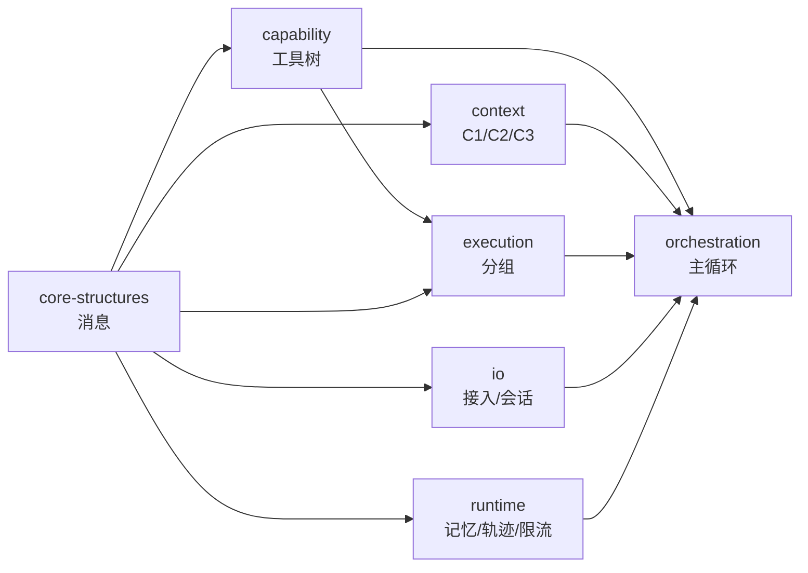

# 实现计划（多分支并行构建）

> 本文件是**执行计划**，不是设计文档。设计见 `docs/01-系统架构设计.md` 与 `docs/02-数据结构设计/`。
> 状态：`TODO` / `WIP` / `DONE`

---

## 1. 分支划分

每个分支独立可测，合并顺序由依赖决定。`main` 只吸收通过验收的分支。

| 分支 | 覆盖范围 | 文档来源 | 验收标准 | 状态 |
|------|---------|---------|---------|------|
| `stage-core-structures` | ADT-3 消息、异常基类 | 02/03-消息 | 无损序列化 | **DONE** |
| `stage-capability` | ADT-4/5/6/7 工具树、DAC、发现清单 | 02/04-工具与权限 | 路径解析 + 权限过滤 + 构建校验 | **DONE** |
| `stage-context` | C1 截断、C2 水位、C3 压缩、ADT 水位状态 | 01 §4.3、02/08 | 截断生效、压缩后 `validate_messages` 通过 | **DONE** |
| `stage-execution` | ADT-9 `BatchPlan`/`ExecGroup`/`ExecResult` | 02/06-执行 | 分组无损、按组序回填、补 3e | **DONE** |
| `stage-io` | ADT-1 接入（双通道）+ ADT-2 会话 | 02/01、02/02 | 安全点消费语义、驱逐与持久化 | **DONE** |
| `stage-runtime` | ADT-8 记忆、ADT-10 轨迹、ADT-11 限流 | 02/05、07、10 | 只追加、按会话隔离、窗口淘汰 | **DONE** |
| `stage-orchestration` | `AgentLoop` / `StepController` / `Dispatcher` | 01 §4.2、§4.6 | 端到端跑通一次工具调用 | **DONE** |
| `stage-assembly-adapter` | `ContextAssembler`、`Adapter`/`ReverseProxy`、Jev 路由 | 01 §4.3/§4.4/§4.8 | 装配稳定 + 低置信回退 + 端到端示例 | **DONE** |

依赖图：



---

## 2. 实现步骤（对应设计文档 §8）

| 步 | 内容 | 分支 | 状态 |
|----|------|------|------|
| 1 | `Message` / `ToolCall` 多态 + 投影 | core-structures | DONE |
| 2 | `ToolTree` / `ToolDef` / DAC | capability | DONE |
| 3 | abstract 节点树查询 + schema 单次下发 | capability | DONE |
| 4 | C1 / C2 / C3 | context | DONE |
| 5 | `BatchPlan` + `ExecGroup` + 安全点 | execution | DONE |
| 6 | 记忆 | runtime | DONE |
| 7 | Jev 路由 + Fallback | runtime | **DONE**（`jev.py`，主模型代为选择） |
| 8 | 异常四类 | execution + orchestration | DONE |
| 9 | 插话双通道 | io | DONE |
| 10 | `TraceEvent` | runtime | DONE |
| 11 | `ContextAssembler` 五段装配 + C1/C2/C3 编排 | assembly-adapter | DONE |
| 12 | 模型适配器（OpenAI / Anthropic）+ `ReverseProxy` | assembly-adapter | DONE |
| 13 | 环境变量配置加载 + 真实调用打通 | assembly-adapter | DONE |
| 14 | 初始配置清单（超参数 / 环境变量 / 布局 / 能力集） | stage-config | DONE |

> 配置清单见 [`04-初始配置清单.md`](04-初始配置清单.md)；对应常量在
> `src/harness/defaults.py`，由 `tests/test_defaults.py` 保证三方一致。

---

## 3.1 真实调用说明

`examples/wiring.py` 默认走真实 HTTP：

```powershell
# 真实调用（密钥从 .env 或进程环境读取）
uv run python examples/wiring.py

# 离线演练（假传输，不发请求）
uv run python examples/wiring.py --dry-run
```

**必须随请求声明 `tools`**：否则模型会把工具调用当作普通文本输出。
`ReverseProxy.chat(..., tools=...)` 负责透传。

**工具名必须编码后出网**：OpenAI 协议要求 `function.name` 匹配
`^[a-zA-Z0-9_-]+$`，不允许 `/`；而内部 `ToolCall.name` 必须是绝对路径（A10）。
适配器在出网/入网边界做可逆转换：

```
/tool/os/file/read  ⇄  tool__os__file__read
```

内部语义与文档约束不变，只有请求体与响应解析使用编码名。


---

## 3. 单元测试策略

| 层 | 测试重点 | 位置 |
|----|---------|------|
| 消息 | 构造期约束、序列级约束、投影逐字节一致 | `tests/test_message.py` |
| 能力 | `build_tree` 分段聚合、`kind` 派生、合成条目、DAC 过滤 | `tests/test_tool_tree.py` |
| 上下文 | 水位阈值各触发一次、压缩边界落在 CallRecord 之间 | `tests/test_context.py` |
| 执行 | 分组等价于 calls、`safe` 相邻合并、补 3e 覆盖全部未回填 | `tests/test_execution.py` |
| 接入 | ② 不消费 `chat`、`control` 清空通道、容量淘汰 | `tests/test_inbox.py` |
| 会话 | 驱逐不删库、恢复置空 `delivered` | `tests/test_session.py` |
| 运行时 | 只追加、JSONL 每行可解析、窗口只按 ts 淘汰 | `tests/test_runtime.py` |

命名约定：测试函数名或类名带约束编号，便于追溯，例如 `test_rejects_orphan_tool_msg_A2`。

---

## 4. 约束检查

`scripts/check_constraints.py` 做三件事：

1. **覆盖检查**：从设计文档抽出全部约束编号（`A1`…`K7`），检查源码注释或测试名中是否出现。
2. **禁止依赖检查**：`pyproject.toml` 的依赖白名单，出现框架类包即失败。
3. **导入边界检查**：`src/harness` 不得导入 `tests`；不得出现 `asyncio` 之外的重型并发库。

运行方式：

```powershell
uv run python scripts/check_constraints.py
```

退出码非 0 表示存在违规，可直接接入 CI。

---

## 5. 提交规范

```
<类型>: <描述>
```

类型：`feat` / `fix` / `tune` / `refactor` / `docs` / `chore`。

每个模块完成即提交，分支内允许多次提交；分支合并回 `main` 用 `--no-ff` 保留边界。
