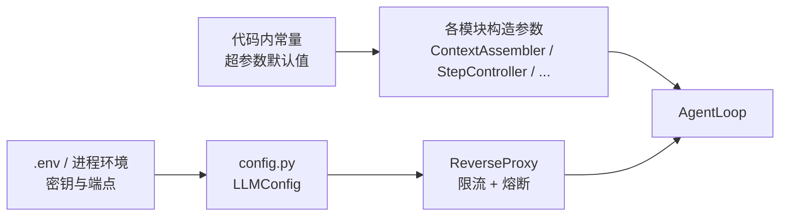

# Orange 初始配置清单

> 本文档是**配置的唯一清单**：超参数、环境变量、文件布局、能力集。
> 每个参数都标注「代码位置 / 默认值 / 影响范围 / 调参建议」，与源码常量一一对应。
> 设计动机见 `docs/01-系统架构设计.md`，实现进度见 `docs/03-实现计划.md`。

---

## 1. 配置分层



| 层 | 来源 | 是否可运行时修改 | 适用参数 |
|---|---|---|---|
| **L1 环境变量** | `.env` 或进程环境 | 否（进程启动时读取） | 密钥、端点、模型名、生成参数 |
| **L2 代码常量** | `src/orange/*.py` | 否（需改代码） | 阈值、容量、超时、并发数 |
| **L3 构造参数** | 实例化时传入 | 否（实例级） | 上下文容量、保留记录数、摘要器 |

> **密钥只走 L1**：`LLMConfig.api_key` 的 `repr` 已掩码，任何日志与异常都不回显明文。

---

## 2. 环境变量（L1）

复制 `.env.example` 为 `.env` 后填写。进程环境变量优先级高于 `.env`（`override=False`），便于 CI 注入。

| 变量 | 默认值 | 必填 | 说明 |
|---|---|---|---|
| `DEEPSEEK_API_KEY` | — | **是** | 密钥。缺失或仍为 `sk-your-key-here` 时抛 `ConfigError` |
| `DEEPSEEK_BASE_URL` | `https://api.deepseek.com` | 否 | OpenAI 兼容端点；尾部斜杠自动去除 |
| `DEEPSEEK_MODEL` | `deepseek-chat` | 否 | 模型名 |
| `LLM_TEMPERATURE` | `0.7` | 否 | 采样温度 |
| `LLM_MAX_TOKENS` | `4096` | 否 | 单次输出上限 |
| `LLM_TIMEOUT` | `60` | 否 | HTTP 超时（秒） |
| `LLM_MAX_RETRIES` | `2` | 否 | 单供应商重试次数（不含首次） |

代码位置：`src/orange/config.py`（`ENV_*` 与 `DEFAULT_*` 常量）。

```powershell
# 最小可用配置
DEEPSEEK_API_KEY=sk-xxxxxxxx
```

```powershell
# 切换到 Moonshot（同为 OpenAI 兼容协议）
DEEPSEEK_API_KEY=sk-xxxxxxxx
DEEPSEEK_BASE_URL=https://api.moonshot.cn/v1
DEEPSEEK_MODEL=moonshot-v1-8k
```

---

## 3. 超参数清单（L2 / L3）

### 3.1 上下文与压缩

| 参数 | 默认值 | 代码位置 | 影响 | 调参建议 |
|---|---|---|---|---|
| `CONTEXT_CAPACITY` | `32768` | `ContextAssembler.capacity` | 水位判定分母 | 与模型真实上下文一致；宁小勿大 |
| `AUTO_1` | `0.50` | `watermark.py` | 一级压缩水位 | 小模型可降到 0.40 |
| `AUTO_2` | `0.75` | `watermark.py` | 二级压缩水位 | 保持 > AUTO_1 |
| `SESSION_END` | `0.85` | `watermark.py` | 收尾水位（不压缩） | 不建议超过 0.90 |
| `CHARS_PER_TOKEN` | `2.0` | `watermark.py` | token 粗估系数 | 中文为主时偏保守，可设 1.6 |
| `MAX_OBS_CHARS` | `4000` | `truncate.py` | C1 单条结果截断上限 | 工具输出多时降到 2000 |
| `keep_records_50` | `4` | `compressor.py` | 50% 水位保留的完整 CallRecord 数 | 复杂任务可增到 6 |
| `keep_records_75` | `2` | `compressor.py` | 75% 水位保留数 | 通常不动 |
| `SUMMARY_PREFIX` | `[上下文摘要]` | `compressor.py` | 摘要消息固定前缀 | 改动会破坏历史摘要合并 |

**硬约束**：每个水位只触发一次（I5）；`SESSION_END` 只收尾不压缩。改阈值不会改变这两条。

### 3.2 循环与终止

| 参数 | 默认值 | 代码位置 | 影响 | 调参建议 |
|---|---|---|---|---|
| `MAX_STEPS` | `40` | `loop.py` | 单会话最大 ReAct 步数 | 长任务可调高；注意 token 成本线性增长 |
| `MAX_INJECTS` | `10` | `loop.py` | 单会话最大插话次数 | 交互密集场景可增 |
| `DEADLOCK_THRESHOLD` | `3` | `loop.py` | 连续同路径同结果失败次数上限 | 低于 2 易误杀，高于 5 浪费 token |

死锁判据需**同时**满足：连续失败、结果 hash 未变、未换工具路径。

### 3.3 执行与并发

| 参数 | 默认值 | 代码位置 | 影响 | 调参建议 |
|---|---|---|---|---|
| `MAX_WORKERS` | `4` | `executor.py` | 单批次并行组线程数上限 | IO 密集可到 8；受 H3 约束 |
| 单会话线程配额 | `MAX_WORKERS // 2` | `session.py`（H3） | 保证至少两会话并发 | 改 MAX_WORKERS 时同步考虑 |
| `CHAT_CAPACITY` | `100` | `inbox.py` | `chat` 通道队列上限，超出丢最旧 | 长时间挂机可增 |
| `control` 容量 | 无限 | `inbox.py` | 中断信号队列 | 不建议限制 |

并发判据不是「是否 IO」，而是**副作用是否可交换**：`caps` 只含 `read` → `safe`，否则 `exclusive`。

### 3.4 工具树与路由

| 参数 | 默认值 | 代码位置 | 影响 | 调参建议 |
|---|---|---|---|---|
| `TREE_ENABLE_THRESHOLD` | `15` | 设计文档 | 工具数低于此值全量暴露 | 少量工具查树纯亏推理 |
| `ROUTE_ENABLE_TOOL_COUNT` | `30` | `jev.py` | Jev 路由启用：工具数下限 | 与上一项配合 |
| `ROUTE_ENABLE_BRANCH_COUNT` | `6` | `jev.py` | 路由启用：分支数下限 | 分支少时路由收益低 |
| `ROUTE_ENABLE_HISTORY_TOKENS` | `4000` | `jev.py` | 路由启用：历史 token 下限 | 短对话不路由 |
| `CONFIDENCE_THRESHOLD` | `0.7` | `jev.py` | 低于此置信度回退全量 | 保守可升到 0.8 |
| `index_depth` | `2`（config）/ `0`（核心）/ `1`（Web） | `tool_tree.py` | `SystemMsg` 第 2 段索引深度；`0` = 全展开 | 深层工具多可设 3（占 token）；Web 服务取 `1` 以启用下钻 |
| `l2_limit` | `40` | `tool_tree.py`（B6） | 索引中 L2 条目上限 | 超出按 description 长度保留 |
| `DEFAULT_MAX_DISCOVERED` | `50` | `discovery.py` | 已发现**叶子**工具清单上限（抽象节点不入缓存） | 按 `(last_used_step, first_seen_step, path)` 淘汰 |
| `description_l1` / `description_deep` | `40` / `80` | `tool_tree.py`（B10） | 索引紧凑度 | 超长自动截断 |

> `orange/defaults.py` 中的字段名与上表一一对应：
> `route_tool_count` / `route_branch_count` / `route_history_tokens` /
> `route_confidence` / `l2_limit` / `description_l1` / `description_deep`。

### 3.5 会话与持久化

| 参数 | 默认值 | 代码位置 | 影响 | 调参建议 |
|---|---|---|---|---|
| `max_resident` | `20` | `session.py` | 内存驻留会话数上限 | 按内存预算调整 |
| `idle_timeout_s` | `1800` | `session.py` | 空闲会话可卸载时限 | 长任务勿调小 |
| `sweep_interval_s` | `60` | `session.py` | 驱逐扫描周期 | 会话多可降到 30 |
| `TURN_TIMEOUT_S` | `300` | `apps/server/sessions.py` | 单轮无进展容忍时长；超过则放弃本轮 | 必须高于 provider 的 HTTP 超时（60s），否则长回答会被误杀 |
| `WATCHDOG_INTERVAL_S` | `15` | `apps/server/sessions.py` | 卡死检测周期 | 扫描极轻，不需调大 |
| `orange.db` | `~/.orange/orange.db` | `session_store.py` | SQLite 位置（WAL） | 全机一个库，按 `working_dir` 区分项目 |
| `sqlite_timeout` | `30.0` | `session_store.py` | 建库/写锁等待 | 高并发可增 |

**驱逐边界**：`active` 永不卸载（H10）；`ended` 立即移除（H12）；卸载只丢内存，不删库（H13）。

### 3.6 模型层限流与熔断

| 参数 | 默认值 | 代码位置 | 影响 | 调参建议 |
|---|---|---|---|---|
| `RateWindow.window_s` | `60` | `rate.py` | 滑动窗口长度 | 与供应商配额周期一致 |
| `max_requests` | `60` | `build_proxy()` | 窗口内请求数上限 | 按账号等级设置 |
| `max_tokens` | `200_000` | `build_proxy()` | 窗口内 token 上限 | 按配额设置 |
| `failure_threshold` | `3` | `rate.py` | 连续失败多少次进入 `degraded` | 网络抖动多可升到 5 |
| `health_backoff_s` | `30.0` | `rate.py` | 退避时长 | 配合指数退避使用 |
| `request_backoff_s` | `1.0` | `model.py` | 单请求重试间隔基数（指数增长） | 通常不动 |

**语义**：`healthy` 正常发送；`degraded` 等待 `retry_after`；`down` 直接失败（K4/K5）。

### 3.7 记忆

| 参数 | 默认值 | 代码位置 | 影响 |
|---|---|---|---|
| `AGENT_DIR_NAME` | `.agent` | `paths.py` | 项目内旧目录（仅作为清单的只读来源，不创建） |
| `WORK_MEMORY_FILENAME` | `WORK.md` | `memory.py` | 工作记忆（每工作目录一份） |
| `LONG_TERM_MEMORY_FILENAME` | `MEMORY.md` | `memory.py` | 长期记忆（全系统唯一） |
| `EXTRACT_PRINCIPLE_FILENAME` | `extract.md` | `memory.py` | 提取原则（用户维护） |
| `_REPLACE_RETRIES` | `40` | `memory.py` | 原子写重命名重试次数（Windows 兼容） |
| `_REPLACE_BACKOFF_S` | `0.002` | `memory.py` | 重试间隔 |

### 3.8 轨迹

| 参数 | 默认值 | 代码位置 | 影响 |
|---|---|---|---|
| `TRACE_DIR_NAME` | `traces` | `trace.py` | 轨迹目录名 |
| 文件粒度 | 一会话一 JSONL | `trace.py`（E3） | 按会话隔离 |
| 写入时机 | 每步追加 + flush | `trace.py`（E1） | 崩溃已有部分轨迹 |

---

## 4. 文件布局

```
<workdir>/WORK.md               工作记忆（项目级，同工作目录多会话共享）

~/.orange/                      全局数据目录，与具体项目无关
├── orange.db                  SQLite：sessions / messages / usage
├── capabilities.json           工具与 skill 清单
├── permissions.json            权限拒绝表
├── skills/<name>/SKILL.md      已安装 skill
└── traces/<session>.jsonl      轨迹（一会话一文件）

<workdir>/.env                  密钥与端点（用户自己的，不迁移）
```

`~/.orange` 的解析顺序：`ORANGE_HOME` → `~/.orange`（全平台统一）。

项目内若已提交 `.agent/capabilities.json` 或 `.agent/permissions.json`，仍会从那里读取（只读优先），但 Orange 不会创建 `.agent` 目录。

| 数据 | 介质 | 生命周期 |
|---|---|---|
| 会话元信息 / 消息 / 用量 | SQLite WAL | 永久 |
| 工作记忆 | Markdown | 跨会话 |
| 长期记忆 | Markdown | 跨项目 |
| 轨迹 | JSONL | 追加 |
| `FlatStore` / `ToolTree` | 内存 | 进程级 |
| `TreeQueryState` / `DiscoveredTools` | 内存 | 会话级，压缩清空 |

**`SystemMsg` 不入库**：恢复时按当前工具树重新装配（H6）。

---

## 5. 能力集

### 5.1 编排能力

| 能力 | 实现 | 默认 |
|---|---|---|
| ReAct 主循环 | `AgentLoop.run()` | 开启 |
| 步数闸门 / 注入计数 | `StepController` | 开启 |
| 死锁判定 | `DeadlockTracker` | 开启 |
| 安全点插话（双通道） | `Inbox` + `AgentLoop` | 开启 |
| 立即插入 | `control` 通道 + 补 3e | 开启 |

### 5.2 上下文能力

| 能力 | 实现 | 默认 |
|---|---|---|
| C1 大结果截断 | `truncate.py` | 开启（4000 字符） |
| C2 水位估算 | `watermark.py` | 开启（chars/2） |
| C3 分段压缩 | `compressor.py` | 需注入 `summarizer`，未注入则无损跳过 |
| `SystemMsg` 五段装配 | `ContextAssembler` | 开启 |
| 已发现工具临时注入 | `to_provider(discovered=...)` | 开启 |

### 5.3 工具与权限能力

| 能力 | 实现 | 默认 |
|---|---|---|
| 扁平存储 → 派生树 | `FlatStore` / `build_tree` | 开启 |
| 路径消歧 | 绝对路径 | 开启 |
| `abstract` 节点树查询 | `tree_query` | 开启 |
| schema 单次下发 | `TreeQueryState` | 开启 |
| DAC 实例级授权 | `AgentPermissions.grants` | 开启（无记录即允许） |
| 挂载 / 卸载 | `FlatStore` + `ToolTree` | 人工操作 |
| 并发分组 | `plan_batch` | 开启 |

### 5.4 执行与异常能力

| 能力 | 实现 | 默认 |
|---|---|---|
| 批次原子分组 | `ExecGroup` | 开启 |
| 组内并行 | `ThreadPoolExecutor` | 开启（4 线程） |
| 参数四道关卡 | `args_validate.py` | 开启 |
| 四类异常降级 | `ExecResult.error_type` | 开启 |
| 幂等决定重试 | `ToolDef.idempotent` | 开启 |

### 5.5 模型能力

| 能力 | 实现 | 默认 |
|---|---|---|
| OpenAI 兼容协议 | `OpenAIAdapter` | 默认 |
| Anthropic 协议 | `AnthropicAdapter` | 可选 |
| 工具声明 | `build_request(tools=...)` | 需调用方传入 |
| 工具名编解码 | `encode/decode_tool_name` | 自动 |
| 全局限流 | `RateWindow` | 开启 |
| 熔断与故障转移 | `ProviderHealth` | 开启 |
| 退避重试 | `ReverseProxy` | 开启（2 次） |

### 5.6 路由能力

| 能力 | 实现 | 默认 |
|---|---|---|
| Jev 工具路由 | `JevRouter`（主模型代为选择） | 满足三阈值才启用 |
| 低置信回退 | `RouteDecision.full()` | 开启 |
| 异常回退 | `try/except` → 全量 | 开启 |

### 5.7 持久化与观测能力

| 能力 | 实现 | 默认 |
|---|---|---|
| 会话持久化 | `session_store.py` | 开启 |
| 组级事务 | `append_group` | 开启 |
| 轨迹 JSONL | `trace.py` | 开启 |
| 用量归集 | `usage` 表 | 开启 |

---

## 6. 启动检查清单

首次运行前逐项确认：

| # | 检查项 | 失败表现 |
|---|---|---|
| 1 | `.env` 存在且 `DEEPSEEK_API_KEY` 非占位符 | `ConfigError: 缺少环境变量` |
| 2 | `uv sync` 完成 | `ModuleNotFoundError` |
| 3 | 工具树构建通过 B1–B4 / B9 / B10 / B19 | 启动即拒绝 |
| 4 | `CONTEXT_CAPACITY` 与模型实际上下文一致 | 频繁 `session_end` 或 API 400 |
| 5 | 工具声明 `tools` 随请求传入 | 模型把调用输出为文本 |
| 6 | 工具名匹配 `^[a-zA-Z0-9_-]+$` | HTTP 400 `Invalid tools[0].function.name` |
| 7 | 工作目录可写（`.agent/` 可创建） | 工作记忆与 SQLite 写入失败 |
| 8 | 若用 C3，已注入 `summarizer` | 压缩静默跳过（不报错） |

快速验证：

```powershell
orange service doctor                      # 逐项自检，不消耗额度
orange config check                        # 校验密钥与数值
uv run python scripts/check_constraints.py # 依赖与约束检查
```

> 端到端的真实调用需要启动服务后在界面上发一条消息（`orange serve`），
> 没有单独的离线演练脚本。

---

## 7. CLI 速查

安装后可直接调用 `orange`（也可用 `uv run orange`）。

### 7.1 服务管理

| 命令 | 作用 | 退出码 |
|---|---|---|
| `orange service status` | 打印各组件状态（能力/会话/存储/上下文/模型） | 0 就绪，1 降级或失败 |
| `orange service status --no-model` | 跳过模型通道，不读密钥不发请求 | 0 |
| `orange service status --allow-degraded` | 降级也返回 0（CI 宽松模式） | 0 |
| `orange service doctor` | 逐项自检并给出修复建议 | 1 仅当密钥或工具树硬失败 |
| `orange service sweep` | 驱逐可卸载的空闲会话 | 0 |
| `orange service tree --depth 2` | 打印工具树索引 | 0 |

### 7.2 超参数与配置

| 命令 | 作用 |
|---|---|
| `orange config show` | 展示全部 7 组默认超参数 |
| `orange config show --with-env` | 额外展示环境变量解析出的模型配置 |
| `orange config get context.capacity` | 按 `group.field` 查询 |
| `orange config get max_steps` | 裸字段名（唯一时自动解析） |
| `orange config env` | 列出 7 个环境变量及当前取值（密钥掩码） |
| `orange config check` | 校验环境变量与数值合法性 |
| `orange config init` | 生成 `.env.example` 模板 |
| `orange config init --output .env --force` | 直接生成 `.env` 并覆盖 |

### 7.3 通用选项

| 选项 | 位置 | 说明 |
|---|---|---|
| `--workdir <path>` | 全局或子命令后 | 工作目录，`.env` 相对它解析；数据目录由 `ORANGE_HOME` 决定 |
| `--json` | 全局或子命令后 | 输出机器可读 JSON，便于脚本与 CI |

**密钥安全**：所有命令只输出 `masked_key()`（如 `sk-e...54b8`），任何路径都不打印明文。

```powershell
# 典型启动流程
orange config init                 # 1. 生成模板
# 编辑 .env 填入真实密钥
orange config check                # 2. 校验配置
orange service doctor              # 3. 逐项自检
orange service status              # 4. 查看运行状态
```

---

## 8. 默认配置速查```bash
# 环境变量（.env）
DEEPSEEK_API_KEY=sk-xxx
DEEPSEEK_BASE_URL=https://api.deepseek.com
DEEPSEEK_MODEL=deepseek-chat
LLM_TEMPERATURE=0.7
LLM_MAX_TOKENS=4096
LLM_TIMEOUT=60
LLM_MAX_RETRIES=2

# 代码常量（src/orange/）
CONTEXT_CAPACITY=32768        # ContextAssembler.capacity
AUTO_1=0.50 AUTO_2=0.75 SESSION_END=0.85
MAX_OBS_CHARS=4000
MAX_STEPS=40 MAX_INJECTS=10
MAX_WORKERS=4
TREE_ENABLE_THRESHOLD=15
JEV_TOOL=30 JEV_BRANCH=6 JEV_TOKENS=4000 JEV_CONFIDENCE=0.7
max_resident=20 idle_timeout_s=1800 sweep_interval_s=60
rate: window_s=60 max_requests=60 max_tokens=200000
health: failure_threshold=3 backoff_s=30
```
