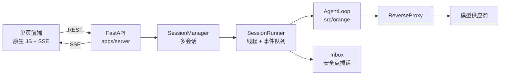

# Web 前端（FastAPI）

> 服务层目录。核心编排包 `src/orange` **保持零 Web 框架**，此处只做包装。
> 该边界由 `scripts/check_constraints.py` 按目录强制执行。

---

## 1. 启动

```powershell
uv run uvicorn apps.server.main:app --reload --port 8000
```

打开 <http://127.0.0.1:8000/>。API 文档见 `/docs`。

前置条件：`.env` 中已配置 `DEEPSEEK_API_KEY`。未配置时页面顶部显示红色提示，
`/api/health` 返回 `ok: false` 并说明原因。

---

## 2. 界面结构

```
┌─────────────────────────────────────────────────────────────┐
│ ORANGE   ● 就绪 · N 会话            [模型 ▾]  [新建会话]     │
├──────────────┬────────────────────────────┬─────────────────┤
│ 会话列表      │  对话流                    │ 轨迹 / 上下文 / 工具 │
│              │                            │                 │
│ a08236d77eba │  U 用户消息                │ 水位 ▓▓▓░░ 5.1%  │
│  done     ×  │  → /tool/os/echo           │ assistant 20:38 │
│              │  ✓ echo 结果               │ tool             │
│ 230f246ec38a │  A 模型回复                │ route            │
│  idle     ×  │                            │ usage            │
│              │ ┌──────────────────────┐   │                  │
│              │ │ 输入…        [发送]  │   │                  │
│              │ └──────────────────────┘   │                  │
└──────────────┴────────────────────────────┴─────────────────┘
```

---

## 3. 功能与操作

### 3.1 多会话

| 操作 | 方式 |
|---|---|
| 新建 | 顶栏「新建会话」，使用当前下拉框选中的模型 |
| 切换 | 点击左侧会话条目 |
| 删除 | 悬停会话条目，点击右侧 `×` |
| 并发 | 不同会话各自独立线程、独立事件队列，可同时推理 |

每个会话持有独立的 `Inbox` / `Watermark` / 消息历史，互不干扰（H1）。
单会话同一时刻只允许一轮推理，重复发送返回 `409`。

### 3.2 模型选择

- 顶栏下拉框决定**新建会话**使用的模型；
- 已存在会话可通过 `PATCH /api/sessions/{id}` 切换（前端暂未暴露按钮，可用 API）。

### 3.3 上下文记录

「上下文」标签页展示完整消息序列（含 SystemMsg），并显示：

- 消息条数
- 估算 token 数
- 水位比例（与轨迹页的进度条同步）

点击「刷新上下文」可拉取最新快照。

### 3.4 实时推理 UI

「轨迹」标签页是**事件流**（最新在上），事件类型：

| 标签 | 含义 | 内容 |
|---|---|---|
| `inject` | 用户插话 | 通道 + 文本 |
| `state` | 会话状态 | `idle` / `running` / `done` / `aborted` / `error` |
| `assistant` | 模型回复 | 文本摘要，或 `tool_calls × N` |
| `tool` | 工具结果 | 路径 + 结果前 60 字 |
| `route` | Jev 路由 | 选中分支或「回退全量」 |
| `compress` | 上下文压缩 | 水位动作 + 剩余条数 |
| `usage` | 用量 | `tokens / capacity` |
| `error` | 错误 | 错误消息 |

推理进行中时，对话流底部显示三点脉冲动画。

### 3.5 插话

| 按键 | 通道 | 语义 |
|---|---|---|
| `Ctrl` + `Enter` | `chat` | 等待插入：不打断工具，在下一个完整安全点生效 |
| `Ctrl` + `Shift` + `Enter` | `control` | 立即插入：下一组边界停止剩余组，补 3e 占位 |

「立即」的真实含义是**最近一个组边界**，最坏延迟等于当前组最慢工具耗时。

---

## 4. 接口一览

| 方法 | 路径 | 说明 |
|---|---|---|
| GET | `/` | 单页前端 |
| GET | `/api/health` | 健康状态（`ok` / `error` / `sessions`） |
| GET | `/api/models` | 可用模型 + 默认模型 |
| GET | `/api/tools` | 工具目录（路径 / 描述 / 并发性 / 幂等） |
| GET | `/api/sessions` | 会话列表 |
| POST | `/api/sessions` | 新建（可指定 `model` / `capacity`） |
| GET | `/api/sessions/{id}` | 详情（可含消息） |
| PATCH | `/api/sessions/{id}` | 切换模型 |
| DELETE | `/api/sessions/{id}` | 删除（运行中会先中止） |
| GET | `/api/sessions/{id}/messages` | 历史 + token 统计 |
| POST | `/api/sessions/{id}/messages` | 发送消息（`chat` / `control`） |
| POST | `/api/sessions/{id}/cancel` | 中止本轮 |
| GET | `/api/sessions/{id}/trace` | 持久化轨迹（工具、路由、下钻） |
| GET | `/api/sessions/{id}/events` | SSE 事件流（支持 `after_seq` / `Last-Event-ID` 断点续传） |

### SSE 帧格式

```
id: 12
data: {"seq":12,"ts":1729000000.1,"kind":"assistant","payload":{...}}

: ping
```

`seq` 在会话内单调递增，前端按它去重并作为断点续传的游标；空闲时每 15 秒发送一次心跳注释。

`EventSource` 无法自定义请求头，所以除 `Last-Event-ID` 外还支持 `?after_seq=N` 查询参数，供已加载历史轨迹的客户端跳过重复回放。

### 事件类型

| kind | 时机 | 是否持久化 |
|---|---|---|
| `delta` | 模型输出的每个文本片段 | ❌ 仅实时预览 |
| `assistant` | 一轮回复完成 | ✅ 消息表 |
| `tool` | 工具结果回填 | ✅ 轨迹表 |
| `route` / `compress` / `usage` / `state` / `error` | 路由、压缩、水位、状态、错误 | ✅ 轨迹表 |
| `inject` | 安全点插入用户消息 | ✅ 轨迹表 |

---

## 5. 内置工具

能力清单位于 `~/.orange/capabilities.json`（项目内 `.agent/capabilities.json` 优先），当前共 15 个工具 + skill + MCP：

| 路径 | 说明 |
|---|---|
| `/tool/os/file/read` | 按行读取工作目录内文本文件 |
| `/tool/os/file/list` | 列出目录条目 |
| `/tool/os/file/write` | 写入文本文件 |
| `/tool/os/file/append` | 追加内容到文件 |
| `/tool/net/http/get` · `post` · `head` | HTTP 请求 |
| `/tool/memory/work/read` · `append` · `replace` | 读写 `WORK.md` 工作记忆 |
| `/mcp/workspace/*` | MCP 服务暴露的文件工具（`list_dir` / `read_file` / `search_text` / `stat_path` / `write_file`） |

**安全边界**：所有文件操作都被限制在工作目录内，越界路径抛 `路径越界`。

---

## 6. 架构



关键约束：

- 前端只通过 `SessionManager` 访问内核，不直接触碰 `AgentLoop` 内部状态；
- 用户消息由前端本地渲染，服务端不再重复发 `inject` 事件（避免重复气泡）；
- 单会话出错只影响该会话（`state: error`），不影响服务进程。

---

## 7. 已知限制

| 限制 | 说明 |
|---|---|
| 无前端模型切换按钮 | 仅提供顶部下拉框，更多参数需 `PATCH /api/sessions/{id}` |
| 无鉴权 | 仅面向本地开发，默认绑定 `127.0.0.1` |
| ~~无历史会话恢复~~ **已支持** | 启动时从 SQLite 恢复最近 10 个会话 |
| ~~无流式 token~~ **已支持** | 事件以 `delta` 逐片段推送，前端实时追加到气泡；提交时以 `assistant` 事件校准 |
